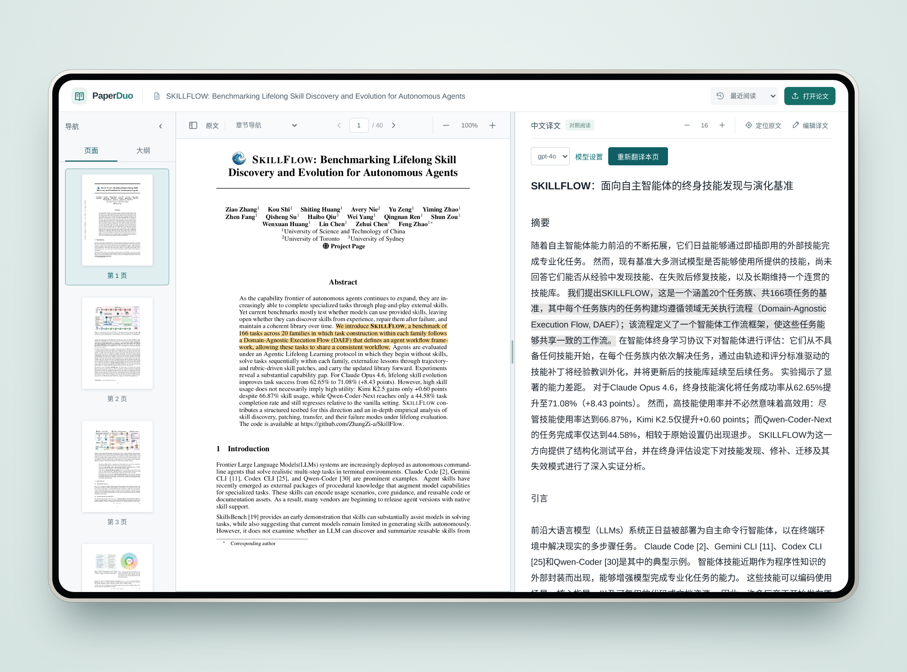

# PaperDuo

本地部署的学术论文双语对照阅读器：左侧原版 PDF，右侧逐句中文译文，支持双向定位、在线编辑与持久化保存。



- **结构化解析**：GROBID 提取论文结构与页面坐标，结合 PDF 文本层校正正文。
- **双向定位**：PDF.js 渲染原文，悬停原文或译文即可高亮并跳转到对应内容。
- **LLM 翻译**：对接任意 OpenAI 兼容 Chat Completions 服务，按整段上下文翻译。
- **个人空间**：个人主页支持编辑用户名、上传或移除头像，并提供阅读概览与继续阅读；知识库支持搜索、分类与未分类，最近阅读按实际打开时间排列，并恢复上次页码。
- **模型设置**：在个人设置中管理服务地址、API Key、默认模型和可选模型。
- **持久化**：SQLite 保存 PDF、解析结果、译文、分类与阅读进度，相同 PDF 自动复用。

## 快速开始

需要 Docker Compose 与约 6 GB 可用内存。

```bash
cp .env.example .env
mkdir -p .reader-data
make up                  # 等同于 docker compose -p paperduo up -d --build
```

打开 [http://127.0.0.1:4174](http://127.0.0.1:4174)。停止服务：`make down`。

## 使用

1. 打开「个人主页 → 个人设置」，填写模型服务地址、API Key、默认 LLM 模型和其他可选模型；阅读时可在译文区的模型下拉框中切换，选择会保存在此浏览器中。
2. 点击顶部 PaperDuo 标识右侧的「打开论文」，进入左侧上传、右侧留空的页面，再点击「选择 PDF」上传不超过 30 MB、带文本层的 PDF；也可在个人主页点击「导入论文」直接选择文件。论文会自动进入个人知识库，支持按标题、作者、文件名搜索，并可选择分类或保留未分类。
3. 在知识库点击论文开始阅读；个人主页的「继续阅读」和「最近阅读」会保留上次页码。分类可新建、改名、删除；删除分类后，论文回到未分类，PDF 和译文仍会保留。
4. 悬停原文或译文可定位另一侧；译文区右上角的 − / + 调整译文字号（默认 16，点数字恢复），设置会被记住；拖动中间分界线调整宽度（双击恢复）；在 PDF 区域用 `Ctrl/⌘ + 滚轮` 或 `Ctrl/⌘ + 加减键` 缩放，`Ctrl/⌘ + 0` 复位。
5. 「翻译本页」生成译文；已有译文时变为「重新翻译本页」，会覆盖包括手动编辑在内的已有内容。
6. 「编辑译文」修改当前页，修改会被保存。

当前个人空间沿用本地单用户部署的数据，不包含账号登录或多用户隔离。

在个人主页点击「编辑资料」可修改用户名（1–32 个字符），上传或移除头像（PNG、JPEG、WebP，不超过 2 MB，自动居中裁剪）。保存后会同步更新顶部和侧栏，刷新页面后仍会保留。

公式与参考文献保留原文。扫描件、复杂公式和特殊版面可能无法可靠解析或定位。

## 项目结构

```
paperduo/            后端（FastAPI）
  server.py            API 与静态资源服务、SQLite 持久化
  translation.py       LLM 翻译与模型设置
  layout.py            PDF 版面处理（图片文字拆分）
web/                 前端（无构建步骤，由后端直接托管）
  index.html
  css/  js/  vendor/   样式、脚本、PDF.js
tests/
  python/              后端单元测试
  web/                 前端单元测试
  e2e/                 Playwright 浏览器检查（需已运行的服务）
Dockerfile  compose.yaml  Makefile  requirements.txt  .env.example
```

## 开发

```bash
make setup                          # 创建 .venv 并安装依赖
docker compose -p paperduo up -d grobid   # 后端依赖 GROBID（默认 127.0.0.1:8070）
set -a; . ./.env; set +a            # 导出 LLM 配置
make dev                            # http://127.0.0.1:4174，自动重载
make test                           # 后端 + 前端单元测试
```

本机运行还需安装 poppler-utils（提供 `pdftotext`，Docker 镜像已内置）。`tests/e2e/*.mjs` 需要 Playwright，用 `READER_URL`、`PLAYWRIGHT_MODULE`、`CHROMIUM_PATH`、`TEST_PDF` 等环境变量指向运行中的实例，参见各脚本开头。

## API

| 方法与路径                               | 说明                                             |
| ---------------------------------------- | ------------------------------------------------ |
| `POST /api/documents`                  | 上传并解析 PDF                                   |
| `GET /api/documents`                   | 完整知识库，含分类、阅读时间与页码                                     |
| `GET /api/documents/{id}`              | 文档结构与译文                                   |
| `GET /api/documents/{id}/pdf`          | 原始 PDF                                         |
| `GET /api/documents/{id}/tei`          | 下载 TEI XML                                     |
| `PUT /api/documents/{id}/translations` | 保存译文                                         |
| `PUT /api/documents/{id}/collection` | 将论文分类或移回未分类 |
| `PUT /api/documents/{id}/reading` | 记录阅读时间与页码 |
| `GET /api/collections` | 分类列表 |
| `GET /api/profile` | 读取用户名和头像 |
| `PUT /api/profile` | 保存用户名和头像 |
| `POST /api/collections` | 新建分类 |
| `PUT /api/collections/{id}` | 修改分类名称 |
| `DELETE /api/collections/{id}` | 删除分类，保留论文 |
| `GET /api/translation/settings` | 读取模型设置（不返回密钥） |
| `PUT /api/translation/settings` | 保存模型设置 |
| `GET /api/translation/models`          | 已配置模型与默认模型                             |
| `POST /api/documents/{id}/translate`   | 翻译片段；`force: true` 跳过已有译文并重新生成 |

基于

[GROBID](https://github.com/kermitt2/grobid)（Apache-2.0）与 [PDF.js](https://github.com/mozilla/pdf.js)（Apache-2.0）。本项目使用 [MIT License](LICENSE)。## 致谢与许可
